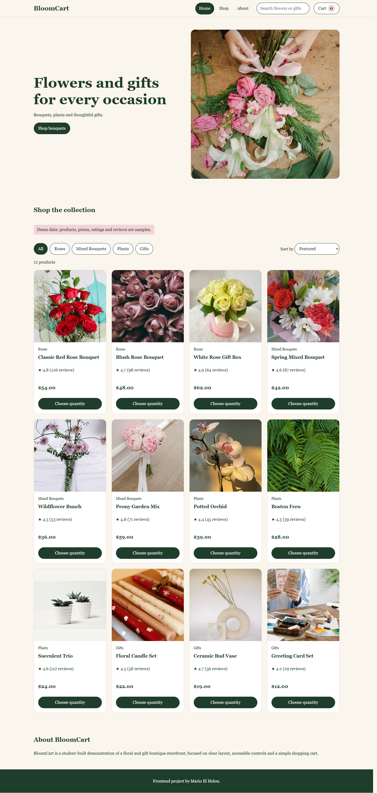
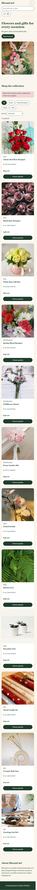
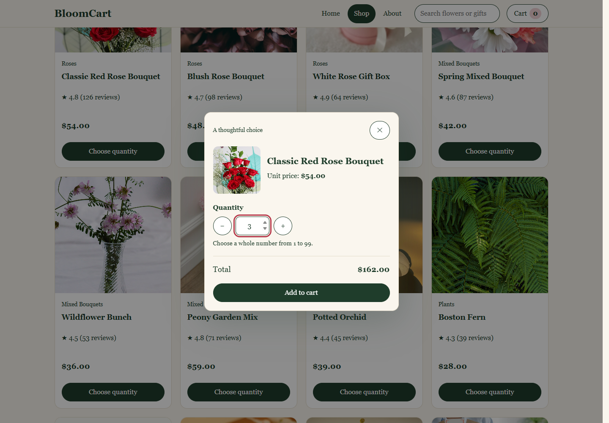
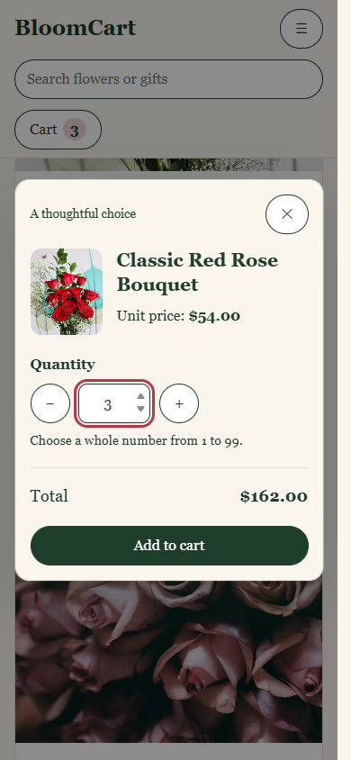
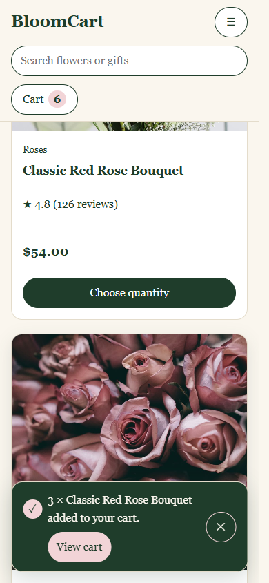

# BloomCart

A responsive floral and gift boutique storefront by **Mario El Helou**, built with HTML5, CSS3, and vanilla JavaScript.

BloomCart presents 12 sample bouquets, plants, and gifts with an ivory, forest-green, and blush design. No build step or runtime dependencies are required.

## Assignment mapping

| Requirement | Implementation |
| --- | --- |
| Floral and gift e-commerce interface | Hero, collection, About section, and interactive cart |
| Product cards with category, high-resolution image, price, and rating | Product records in `js/products.js`, rendered by `js/app.js`, with local photographs |
| Sticky navigation, search, and cart counter | Sticky header, labeled search form, and quantity badge |
| Responsive Grid/Flexbox | Responsive hero and product grids, flexible toolbar and header, and mobile navigation |

## Features and technologies

- Search and category filters combined with featured or ascending/descending price sorting.
- Result count, empty-results message, and reset control.
- Home, Shop, and About links with hover, keyboard-focus, and scroll-aware active states.
- Product quantity dialog with a photograph, unit price, editable quantity, and live total.
- Confirmation toast with View cart and Dismiss actions.
- Cart drawer with quantity controls, removal, line totals, and USD subtotal.
- Integer-cent calculations and validated `localStorage` persistence.
- Maximum quantity of 99 per product.
- Keyboard focus containment, Escape/backdrop dismissal, background interaction prevention, and focus restoration.
- Accessible status announcements and a skip link.
- Responsive mobile menu and sticky-header anchor spacing.
- Smooth drawer, dialog, backdrop, toast, and button transitions.
- Reduced-motion support.
- Optimized local JPEG photographs.
- No remote fonts, frameworks, or image requests at runtime.

## Folder structure

```text
BloomCart/
├── index.html
├── README.md
├── SUBMISSION.md
├── css/
│   └── styles.css
├── js/
│   ├── app.js
│   └── products.js
├── assets/
│   └── images/                  13 JPEG photographs
└── docs/
    ├── EXPLANATION.md
    ├── TESTING.md
    ├── browser-check.cjs
    ├── browser-results.json
    ├── purchase-check.cjs
    ├── purchase-results.json
    ├── purchase-package-results.json
    ├── motion-check.cjs
    ├── motion-results.json
    ├── motion-package-results.json
    ├── package-browser-results.json
    ├── serve.cjs
    ├── screenshot-desktop.png
    ├── screenshot-mobile.png
    ├── screenshot-purchase-desktop.png
    ├── screenshot-purchase-mobile.png
    └── screenshot-toast-mobile.png
```

## Run locally

### Open directly

Open `index.html` in a browser to view the static website.

### Use a local server

With Node.js installed, open a terminal in the project folder containing `index.html` and run:

```powershell
node docs/serve.cjs .
```

Open **http://127.0.0.1:8000/**.

Keep the terminal open while using the website. Press **Ctrl+C** to stop the server. No npm installation is needed to run the website.

### Test a repository-style URL prefix

From the parent directory containing the `BloomCart` folder, run:

```powershell
node BloomCart/docs/serve.cjs .
```

Open **http://127.0.0.1:8000/BloomCart/**.

This serves the project under a URL prefix similar to a GitHub Pages project site.

## GitHub Pages deployment

1. Place the contents of the project folder at the repository root. `index.html` must sit beside `css`, `js`, `assets`, and `docs`.
2. Commit the files to `main`.
3. Open **Settings → Pages**.
4. Under **Build and deployment**, select **Deploy from a branch**.
5. Select **main** and **/(root)**, then save.
6. Wait for deployment and open the URL GitHub provides.
7. Verify images, search, product dialogs, and cart behavior on the deployed website.
8. Update the repository and live-demo placeholders in `SUBMISSION.md`.

Keep ZIP archives and temporary verification folders outside the repository.

## Screenshots

Browser captures include the complete page and purchase interactions.

Desktop viewport: **1440 × 1000**. Mobile viewport: **390 × 844**.

Expand a preview below. Click an image to open the full-size screenshot.

<details>
<summary><strong>Desktop storefront</strong></summary>

<a href="docs/screenshot-desktop.png">
  
</a>

</details>

<details>
<summary><strong>Mobile storefront</strong></summary>

<a href="docs/screenshot-mobile.png">
  
</a>

</details>

<details>
<summary><strong>Product quantity dialog — desktop</strong></summary>

<a href="docs/screenshot-purchase-desktop.png">
  
</a>

</details>

<details>
<summary><strong>Product quantity dialog — mobile</strong></summary>

<a href="docs/screenshot-purchase-mobile.png">
  
</a>

</details>

<details>
<summary><strong>Add-to-cart confirmation — mobile</strong></summary>

<a href="docs/screenshot-toast-mobile.png">
  
</a>

</details>

## Purchase flow and limits

**Choose quantity** opens the selected product with an initial quantity of 1. Minus, plus, or direct input updates the total using integer-cent calculations.

Blank, nonnumeric, fractional, negative, zero, or greater-than-99 quantities display an inline error and cannot be confirmed.

The cart also limits each product to 99 units overall. An addition exceeding the remaining capacity is rejected with an explanation rather than silently reduced.

A valid confirmation:

1. Adds exactly the selected quantity once.
2. Updates the cart badge, totals, and saved cart.
3. Restores focus to the triggering control.
4. Displays and announces a confirmation toast.

The cart does not open automatically after an addition. **View cart** opens the existing drawer.

Both overlays support keyboard focus containment, background interaction prevention, scroll locking, and dismissal through Escape, the close button, or the backdrop. Only one overlay is open at a time.

The toast remains visible for approximately five seconds. Hovering or focusing it pauses dismissal; leaving resumes the remaining duration. Closing the cart after opening it from the toast returns focus to the persistent header Cart button.

## Animation behavior

Animations use `transform` and `opacity` to avoid layout shifts.

- Drawer, dialog, and backdrop transitions take approximately 270ms.
- Toast and control feedback take approximately 180ms.
- The cart badge uses a restrained 200ms pulse.
- Confirming an addition updates the cart and storage immediately.
- The disabled confirmation button briefly displays “✓ Added to cart” while the dialog exits.
- Exit animations finish before overlays are hidden.
- Reopening an overlay interrupts its exit without allowing an old completion to hide it.
- Focus and scroll locks remain active through the appropriate transition states.

Reduced-motion preferences remove overlay movement, badge pulses, and control transitions. Changing that preference also finishes motion already running.

Hover effects and hover-paused toast timing apply only to devices with a fine pointer and hover support.

## Testing and documentation

Documentation and screenshots were refreshed on **27 October 2026**.

See:

- [Project explanation](docs/EXPLANATION.md)
- [Testing instructions, recorded results, and limitations](docs/TESTING.md)
- [Submission details](SUBMISSION.md)

Browser verification scripts and recorded results are included in `docs/`. Running browser checks requires their separate testing dependencies; those dependencies are not needed to use the website.

## Image credits

Source pages and the [Pexels License](https://www.pexels.com/license/) were checked during project preparation on **26 October 2026**.

All thirteen photographs below use the Pexels License. Credits are retained for reference. These images illustrate demonstration products and do not imply endorsement.

| Local file in `assets/images/` | Creator | Source |
| --- | --- | --- |
| `hero.jpg` | Amina Filkins | [Florist making bouquet](https://www.pexels.com/photo/florist-making-bouquet-of-fresh-flowers-5414002/) |
| `rose-red.jpg` | Ella Wei | [Red rose bouquet](https://www.pexels.com/photo/a-bouquet-of-red-roses-6414329/) |
| `rose-blush.jpg` | Anna Shakhrai | [Blush roses](https://www.pexels.com/photo/elegant-bouquet-of-blush-pink-roses-28759039/) |
| `rose-white.jpg` | angel. | [White roses in box](https://www.pexels.com/photo/elegant-white-rose-bouquet-in-pink-box-display-28961963/) |
| `mixed-spring.jpg` | Sharmina Khan | [Spring bouquet](https://www.pexels.com/photo/colorful-spring-bouquet-with-flowers-36865677/) |
| `mixed-wild.jpg` | Rahime Gül | [Wildflowers](https://www.pexels.com/photo/a-bunch-of-wildflowers-in-a-vase-17081017/) |
| `mixed-peony.jpg` | Melike B | [Peony bouquet](https://www.pexels.com/photo/close-up-of-peony-bouquet-12615496/) |
| `plant-orchid.jpg` | Navya Manoj | [Orchid in pot](https://www.pexels.com/photo/white-orchid-in-a-pot-17430248/) |
| `plant-fern.jpg` | Trygve Finkelsen | [Boston fern](https://www.pexels.com/photo/green-boston-fern-2893181/) |
| `plant-succulent.jpg` | Ylanite Koppens | [Succulent trio](https://www.pexels.com/photo/selective-focus-photography-of-three-succulent-plants-796620/) |
| `gift-candle.jpg` | betül nur akyürek | [Floral candles](https://www.pexels.com/photo/decorative-scented-candles-with-floral-patterns-34654830/) |
| `gift-vase.jpg` | KATRIN BOLOVTSOVA | [Ceramic vase](https://www.pexels.com/photo/dried-flowers-in-ceramic-vase-9130691/) |
| `gift-card.jpg` | Katya Wolf | [Handmade greeting cards](https://www.pexels.com/photo/a-person-holding-greeting-cards-8716166/) |

The hero photograph is 1600px wide; product photographs are 1000px wide, retaining their original aspect ratios. CSS crops images without stretching them. Cart thumbnails reuse the corresponding product photographs.

Images were resized and compressed through the Pexels CDN. All photographs are stored locally, and no AI-generated images are used.

## Frontend and demo limitations

- Product names, prices, ratings, and review counts are sample data.
- Photographs are representative.
- There is no checkout, payment collection, account system, real inventory, order processing, shipping, or backend.
- Cart data is specific to the browser and origin. It does not transfer between localhost and GitHub Pages.
- Saving is best-effort when browser storage is disabled or full; the in-page cart remains usable.
- See [testing details and limitations](docs/TESTING.md) for verification scope.

## Author

**Mario El Helou**

Built for the Pynexia Tech frontend development assignment.
